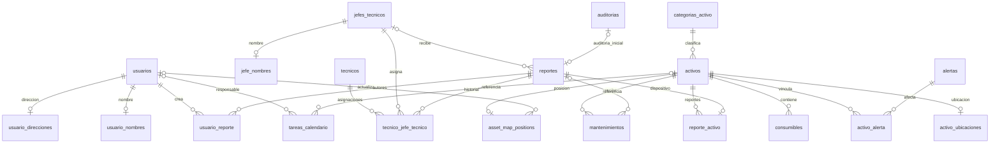

# PreventiTI — Memoria técnica consolidada

**Corte:** 20/10/2026, America/Montevideo. **Propósito:** retomar el desarrollo sin arrastrar versiones superadas.

Esta memoria consolida el chat actual, los chats técnicos accesibles de la misma carpeta, código, migraciones, MER, documentación y la SQLite local consultada en modo de solo lectura. Se contrastaron también los originales locales `Entrega del Primer Hito de Base de Datos.md` y `Base de datos txt backup.md`. No certifica un despliegue externo ni revalida todos los adjuntos históricos.

**Criterio:** las decisiones explícitas posteriores determinan los requisitos; el esquema y código actuales determinan lo implementado. Una diferencia entre ambos queda pendiente, no se resuelve suponiendo que el código ya cumple. Las propuestas del asistente no equivalen a decisiones aprobadas.

La depuración es documental: se omiten repeticiones y conversaciones accesorias en esta memoria. No se borraron chats, datos operativos, archivos históricos ni respaldos. Solo se añadieron esta memoria y su [anexo de esquema físico](../auditoria/esquema_local_2026-10-20.json), sin filas de usuarios, credenciales ni otros registros operativos.

## 1. Decisiones y alcance confirmados

- Continuar el proyecto existente; conservar arquitectura y compatibilidad. Demostración académica con datos simulados, preparada para una futura implementación real. No incorporar tickets.
- **Motor elegido: MariaDB**; SQLite es la réplica de desarrollo en macOS. Se mencionó el traslado a Windows 11 para conectar la base original. La infraestructura de laboratorio documentada aloja Laravel/MariaDB en Ubuntu: distinguir ambos escenarios antes de desplegar.
- **Todos los hitos 1 fueron declarados aprobados por el usuario.** Redes/Seguridad también fue declarada aprobada con su arquitectura vigente. Conservar evidencias; las matrices anteriores que los muestran abiertos no describen esa aprobación posterior.
- Equipo: Ramiro Rebello, coordinación y Laravel; Daniel Sanz, datos; Ignacio de la Rosa, infraestructura y seguridad.
- **40 usuarios:** 3 administradores, 1 jefe técnico, 6 especialistas y 30 empleados. Los seis especialistas mantienen **3 Hardware, 1 Software y 2 Redes/Infraestructura**, por confirmación posterior de conservar el reparto. El jefe tiene además una fila en `tecnicos`, actualmente Hardware: hay 7 filas técnicas, no 7 especialistas. Los dos perfiles genéricos siguen siendo demostrativos; no hay obligación vigente de reemplazarlos por personas reales.

| Catálogo de activos confirmado | Cantidad | Frecuencia de servicio |
| --- | ---: | ---: |
| Terminales | 30 | 90 días |
| Equipos portátiles | 10 | 180 días |
| Impresión | 4 | 60 días |
| Cartelería digital | 3 | 120 días |
| Seguridad CCTV | 10 | 90 días |
| Climatización IoT | 6 | 60 días |
| Protección eléctrica | 6 | 90 días |
| **Total** | **69** | |

El inventario gestionado y los equipos que alojan/conectan el sistema tienen alcances distintos. No sumar servidores o switches al catálogo para hacer coincidir un diagrama.

## 2. Arquitectura implementada

Monolito **Laravel + Eloquent + API JSON**, con servicios de negocio, Form Requests y políticas. `composer.json` exige PHP `^8.3` y Laravel `^13.17`; `composer.lock` fija Laravel **13.30.1**. Se mantiene esa versión; las referencias a Laravel 12/PHP 8.2 no describen el entorno actual.

La SPA usa JavaScript, Blade, Tailwind, Lucide y Chart.js. El mapa usa Three.js local. `resources/views/app.blade.php` carga los archivos de `public/js` y `public/css`. **Actualización del 22/10/2026:** Tailwind, Lucide, Chart.js y las fuentes del login se sirven localmente, con versiones fijadas y recursos generados mediante `npm run build`. La ejecución no requiere Node ni acceso a CDN. `public/js/app.js` coordina módulos ES nativos en `core/`, `features/`, `lib/` y `ui/`. Las vistas parciales y modales están en `resources/views/app/`. `index.html` y `public/index.html` se conservan como redirecciones de compatibilidad. No hay `.git` en esta carpeta. Ver [estructura actual](../ESTRUCTURA.md).

La API persiste operaciones, pero la integración SPA sigue siendo parcial: reportes y posiciones del mapa usan el servidor; los formularios de mantenimiento, consumibles y calendario aún conservan operaciones locales. Estadísticas/costos utiliza datos semilla y cantidades fijas; no existen tablas de presupuestos, precios ni tipos de cambio.

## 3. Modelo lógico y físico vigente

Hay **18 tablas de dominio**, más `tareas_calendario` y `asset_map_positions`, y 8 tablas técnicas de Laravel. El [anexo](../auditoria/esquema_local_2026-10-20.json) conserva columnas, tipos SQLite, nulabilidad, defaults, PK, FK, índices y conteos exactos.

**Notación:** `?` nullable; `UQ` único; `→` FK física. Salvo las PK compartidas/compuestas indicadas, la PK es `id` autoincremental. `T` añade `created_at?`, `updated_at?`. Los dominios ENUM se detallan debajo.

| Tabla / entidad | Atributos y claves de la implementación |
| --- | --- |
| `usuarios` | `id`; `cedula? UQ`, `email UQ`, `rol`, `numero_telefono?`, `password`, `activo`, `remember_token?`, `nombre_completo?`, `direccion?`; T. |
| `usuario_nombres` | PK/FK `usuario_id → usuarios`; `nombre`, `apellido?`. |
| `usuario_direcciones` | PK/FK `usuario_id → usuarios`; `calle?`, `numero_calle?`. |
| `tecnicos` | PK `id` sin autoincremento; `tipo_tecnico`. Coincidencia con `usuarios.id` por convención, **sin FK**. |
| `jefes_tecnicos` | PK `id` sin autoincremento; `nombre_completo`. Coincidencia con `usuarios.id` por convención, **sin FK**. |
| `jefe_nombres` | PK/FK `jefe_id → jefes_tecnicos`; `nombre`, `apellido?`. |
| `categorias_activo` | `id`; `nombre UQ`, `descripcion?`, `requiere_consumible`; T. |
| `activos` | `id`; `categoria_id → categorias_activo`, `serial UQ`, `descripcion`, `estado_activo`, `fecha_alta`, `frecuencia_service`, `ubicacion?`; T. |
| `activo_ubicaciones` | PK/FK `activo_id → activos`; `piso?`, `sala?`. No es un catálogo independiente de salas. |
| `auditorias` | `id`; `fecha_auditoria`, `descripcion`. Sin FK estructurada a actor/evento para cada entrada. |
| `reportes` | `id`; `jefe_id? → jefes_tecnicos`, `auditoria_id? UQ → auditorias`; `historial?`, `estado_reporte`, `urgencia`, `descripcion`, `fecha_creacion`, `fecha_cierre?`, `resolucion?`, `informe_accionar?`, `diagnostico_final?`; T. |
| `usuario_reporte` | PK compuesta `(usuario_id, reporte_id)`; ambas FK. Admite varios autores físicamente; la aplicación crea uno y serializa el primero. |
| `reporte_activo` | PK SQLite `(reporte_id, activo_id)`; ambas FK; **UQ adicional sobre `reporte_id`**. Máximo un activo por reporte. |
| `tecnico_jefe_tecnico` | PK `(tecnico_id, jefe_id, reporte_id, fecha_asignacion)`; tres FK a técnicos, jefes y reportes; `fecha_finalizacion?`, `motivo_reasignacion?`. Una fila es una asignación histórica. |
| `alertas` | `id`; `nivel_alerta` textual, `tipo_alerta`, `fecha_generacion`, `estado_alerta`, `urgencia`; T. No contiene `reporte_id` ni destinatario individual. |
| `activo_alerta` | PK `(activo_id, alerta_id)`; ambas FK. |
| `mantenimientos` | `id`; `activo_id → activos`, `reporte_id? → reportes`, `fecha_mantenimiento` DATE, `descripcion`, `observaciones?`; T. No tiene FK al técnico ejecutor. |
| `consumibles` | `id`; `activo_id → activos`, `nombre`, `tipo`, `nivel` numérico; T. DDL MariaDB: `DECIMAL(5,2)`. |
| `tareas_calendario` | `id`; `fecha`, `hora`, `titulo`, `tipo`, `category`, `technician_id? → usuarios`, `technician_name?`, `asset_id? → activos`, `asset_code?`, `priority`, `completed`; T. |
| `asset_map_positions` | PK/FK `activo_id → activos`; `floor`, `room`, `x`, `z`, `elevation`, `rotation`, `updated_by? → usuarios`; T. |

**Dominios y derivados:**

- `usuarios.rol`: `Administrador`, `Empleado`. `tecnicos.tipo_tecnico`: `Hardware`, `Software`, `Redes/Infraestructura`. `reportes.urgencia` y `alertas.urgencia`: `Critico`, `Alto`, `Medio`, `Bajo`.
- Roles efectivos: administrador → jefe técnico → técnico → empleado, niveles 1–4 y esa precedencia; no implica herencia total de permisos.
- Código de reporte derivado: `REP-{año}-{id con al menos 4 dígitos}`. No es una columna ni un ULID.
- Código, nombre y responsable del activo se extraen de texto legado en `descripcion`; sin código legado se genera `ACT-{id}`. Responsable no es una FK a usuario. Nombre visible del usuario se obtiene de `usuario_nombres`.
- Próximo mantenimiento = último mantenimiento + `frecuencia_service`; sin mantenimiento previo puede ser `null`. Técnico ejecutor y próxima fecha histórica se conservan como texto en `observaciones`.
- Estados de reporte y activo son texto en BD; el grafo de transición se aplica en servicios, no mediante ENUM/trigger del motor.
- Tablas técnicas: `migrations`, `sessions`, `password_reset_tokens`, `cache`, `cache_locks`, `jobs`, `job_batches`, `failed_jobs`. `sessions.user_id` está indexado, sin FK. La tabla de tokens no demuestra que exista un flujo de recuperación de contraseña implementado.

### MER consolidado de relaciones físicas

El [MER editable histórico](PREVENTITI_MER_HITO1.drawio) necesita actualización. Este esquema refleja las restricciones actuales; `0..1` expresa opcionalidad física, aunque una operación de alta requiera crear el vínculo.

Usuario–Técnico/Jefe no se dibuja como FK porque no existe. Activo–Reporte resulta **1:N**, con 0..1 activo por reporte histórico; Usuario–Reporte y Activo–Alerta siguen siendo N:M físicos. Las tablas de nombres, dirección, ubicación y posición permiten como máximo una fila por titular. Consumibles es 1:N, aunque varias consultas usan solo el primero.

**Integridad:** se restringe borrar una categoría con activos y un activo vinculado a reportes/mantenimientos. Las FK de detalle/pivote se eliminan en cascada según el anexo. Borrar el jefe o auditoría referenciados por un reporte deja esa FK en NULL; también son SET NULL las referencias opcionales de calendario, `mantenimientos.reporte_id` y `asset_map_positions.updated_by`. La asignación tiene CASCADE a jefe en SQLite, distinto del DDL entregado (RESTRICT).

Índices funcionales: activos `(categoria_id, estado_activo)`; reportes `(estado_reporte, urgencia)`; asignaciones `(reporte_id, fecha_finalizacion)`; mantenimientos `(activo_id, fecha_mantenimiento)`; consumibles `(activo_id, nivel)`; calendario `(fecha, completed)`, además de PK/UQ.

## 4. Reglas funcionales vigentes

### Reportes, asignaciones y notificaciones

1. Usuario activo crea un reporte sobre **un dispositivo exacto**. Descripción: 5–2000 caracteres; prioridad de entrada: Baja/Media/Alta/Critica. El servicio rechaza activos cuyo indicador `activo` sea falso: Retirado o Fuera de Servicio.
2. La transacción crea auditoría, reporte, vínculos de autor/activo y alerta persistida. Estado inicial único: **Recibido/Derivado**. `jefe_id` señala destinatario, no una asignación automática de técnico.
3. Solo el jefe consulta técnicos disponibles, asigna/reasigna y cambia estados. Cada reporte tiene como regla **un único técnico vigente**; reasignar conserva anterior, fecha y motivo (5–2000 caracteres). El jefe no se autoasigna; no se asigna un reporte finalizado. La asignación por sí sola no avanza el estado.
4. Transiciones: `Recibido/Derivado → En curso → Diagnóstico → Finalizado`, más `En curso → Finalizado`. En curso exige técnico. Diagnóstico exige informe y diagnóstico; Finalizado exige informe y fija fecha de cierre. Informe/diagnóstico: hasta 5000 caracteres, mínimo 5 cuando se suministran. No existe reapertura implementada.
5. Diagnóstico representa una atención aún no resuelta o que necesita tiempo. El campo técnico se llama `diagnostico_final`; conservar la distinción entre nombre del atributo y resolución del reporte. El cierre directo puede no tener diagnóstico.
6. Administración y jefe consultan todos los reportes; especialistas y empleados, solo los que crearon. Estar asignado no concede por sí solo acceso adicional en la política actual.
7. **Requisito confirmado posterior: administradores y jefe deben poder consultar notificaciones. Pendiente:** rutas/controlador/permisos/prueba todavía bloquean al administrador. No extender por inferencia el permiso de marcar leída. Actualmente la lectura es un estado compartido en `alertas`, no individual por destinatario.

### Activos, mantenimiento, consumibles y mapa

- Alta, baja lógica/reactivación y edición de coordenadas: administrador. Baja lógica utiliza `Retirado` y conserva historial. Baja física: solo jefe y únicamente sin reportes ni mantenimientos; el código no exige un retiro previo. No habilitar al administrador esas funciones por jerarquía.
- Técnicos, jefe y administradores consultan inventario/mantenimientos/consumibles y pueden registrar mantenimiento/actualizar insumos. No inventar restricciones por especialidad: falta un mapeo aprobado especialidad–categoría.
- Semáforo: crítica si retirado/fuera de servicio o mantenimiento vencido; atención si faltan hasta 7 días o consumible ≤20%; normal en los demás casos. Nivel admitido por API: 0–100.
- Mapa: 69 activos del backend; 8 áreas simuladas por piso/sala. Posiciones automáticas `schematic` no se guardan; las confirmadas tienen prioridad y caducan al cambiar de sala. API: X/Z entre 0,05 y 0,95; elevación 0–4 m; rotación 0–360°. Dimensiones de salas no son un levantamiento real. Nunca inventar equipos para completar la imagen.

### Cambios recientes que deben conservarse

- **Reportes:** Kanban/Lista, colores por estado y filtros de prioridad/técnico; cambios visuales sin alterar el flujo.
- **Historial:** lista completa autorizada, agrupada por creación, orden reversible, buscador sin distinción de tildes, filtros de estado/dispositivo/técnico/fechas inclusivas y páginas de 20. Muestra reporte, informe, diagnóstico, dispositivo, técnico e historial de asignaciones. No crea una tabla nueva ni reconstruye datos históricos ausentes.
- **Estadísticas y Costos:** cambio exclusivo de indicadores: UYU hasta 20.000 inclusive, USD por encima. Cifras, casillas y gráficos se conservaron. **No hay conversión monetaria ni tipo de cambio**; no interpretar ese cambio visual como importes financieros convertidos.

## 5. Pendientes y discrepancias que no deben perderse

| Prioridad | Evidencia y trabajo pendiente |
| --- | --- |
| Alta · seguridad | Siguen `switch-user` sin autorización específica, sustitución de identidad mediante `X-User-Id` en local/testing, acceso demo con contraseña compartida y API con sesión sin CSRF efectivo. Resolver antes de exposición externa; revisar límites de intentos y separación de datos locales entre sesiones. |
| Alta · permisos | Aplicar consulta de notificaciones para administradores según decisión posterior. Precisar alcance de dashboard/calendario y autorización por tarea; hoy el calendario devuelve todas las tareas y valida el destinatario como usuario existente, no como técnico activo. Unificar `activos`/`inventario` entre permisos y router. |
| Alta · contrato de datos | Validar MariaDB con una copia aislada. El DDL original usa `bdpreventiti` y nombres como `Usuario`, `Reporte_Activos`; el adaptado usa `preventiti`, plural/snake_case, tamaños/tipos/nulabilidad y reglas de borrado diferentes. Por ejemplo, `Alerta.Nivel_Alerta` era entero 0–100 y ahora es texto de urgencia. La identidad compartida usuario–técnico–jefe necesita un mapeo explícito: no está garantizada por FK. |
| Alta · trazabilidad | `alertas` no enlaza directamente al reporte: el controlador obtiene el más reciente del activo, que puede ser otro reporte. La auditoría posterior a la creación es texto, sin relación estructurada con reporte/actor. Preservar antecedentes al diseñar una mejora. |
| Alta · asignaciones | La unicidad del técnico vigente por reporte está en el servicio, no en una UQ del motor. Revisar concurrencia, validación de técnico activo y colisiones de la PK temporal. Finalizar un reporte no cierra automáticamente la fila de asignación vigente. |
| Media · documentación/esquema | El MER conserva la PK antigua de asignación y Reporte–Activo N:M; le faltan informe/diagnóstico y extensiones recientes. El DDL MariaDB omite `asset_map_positions`; el default SQLite de estado sigue siendo `Abierto` aunque el servicio siempre escribe el inicial nuevo. SQLite carece del CHECK 0–100 del DDL para consumibles. |
| Media · conservación histórica | Reportes **102, 106 y 107** carecen de vínculo de activo después de la conciliación. Deben conservarse y recuperar su referencia histórica desde respaldos/auditoría si procede, sin reasignaciones supuestas. Referencias semilla 104/105/106/107 y mantenimiento 204 presentan discrepancias ID–código documentadas; conciliar con evidencia. |
| Media · normalización | `usuarios.nombre_completo/direccion` coexisten con tablas descompuestas y están NULL en las 40 filas locales; ubicación también está duplicada. Revisar fuente canónica/sincronización. Los `hasMany` de nombres/direcciones no reflejan su PK única; `hasOne` de consumible reduce una relación física 1:N. No declarar 3FN integral sin resolver estas duplicidades y atributos incrustados en texto. |
| Media · integración | Completar edición general de activos y administración de catálogos, funciones aceptadas pero no implementadas. Conectar formularios locales a API; no confundir un toast/localStorage con persistencia. Revisar también periodos/indicadores fijos, datos demo residuales y filtrado estadístico por nombre de especialidad sin mapeo aprobado. |
| Media · insumos | El catálogo histórico menciona filtros y baterías; seeder marca consumible solo en impresión, mientras existen 16 filas de consumibles. Revisar regla y consistencia de indicadores antes de eliminar o recrear registros. |
| Media · interfaz/seguridad | Los renderizados actuales de Kanban, Lista e Historial escapan texto; el antiguo hallazgo específico de descripción sin escape en esa tabla fue superado. Persisten interpolaciones sin escape en otras vistas: revisar los puntos actuales, no reutilizar números de línea antiguos ni declarar solucionado todo XSS. |
| Media · despliegue | Configuración Nginx aún apunta a PHP 8.2-FPM, incompatible con el requisito PHP ≥8.3. Faltan validación MariaDB, restauración de respaldo, evidencia de sistemas y control de versiones. Aprobación académica no equivale a seguridad/productividad verificadas. |
| Por definir | Hosting Vercel/Firebase y login Google se consultaron como posibilidades: **no hay decisión de migración ni OAuth implementado**. Alcance de lectura individual de notificaciones, mayor acceso del técnico asignado, modelo financiero real y otros cambios no confirmados siguen abiertos. |

El reparto antiguo 2/2/2 por especialidad discrepa de la conservación posterior de 3/1/2; corregir la documentación académica si corresponde, sin modificar usuarios automáticamente. La guía de conexión antigua contiene conteos y pasos destructivos obsoletos; no usarla como procedimiento de migración.

## 6. Infraestructura confirmada que se conserva

- VLAN 10: `192.168.10.0/24`, gateway `.1`, DHCP `.50–.200`. VLAN 20: `192.168.20.0/24`, gateway `.1`; Ubuntu `.10`, Windows Server `.20`.
- pfSense y exactamente dos reglas **inter-VLAN**: permitir TCP/443 a `192.168.20.10`; bloquear TCP/22 y TCP/3306 desde VLAN 10. Acceso directo por `https://preventiti.local`.
- WireGuard `10.10.0.0/24`, servidor `.1`, peer técnico `.2/32`, UDP/51820. Controles WAN/VPN se documentan aparte. No cambiar IP/VLAN ni rehacer la arquitectura aprobada.
- IP de gestión de switches/AP, DNS y WAN no confirmadas continúan como propuestas/por relevar. **Actualización del 22/10/2026:** la interfaz obtiene métricas reales del servidor, comprueba conexiones TCP desde ese servidor y crea respaldos verificables de SQLite y `storage/app`. Estas operaciones no acreditan reglas inter-VLAN ni estado de WireGuard. El script MariaDB histórico se conserva; no se ejecuta desde la interfaz. Ver [alcance operativo](../guias/INFRAESTRUCTURA_OPERATIVA.md).

## 7. Versiones descartadas como referencia vigente

| Referencia superada | Sustitución / tratamiento |
| --- | --- |
| 78 activos / 38 usuarios | Catálogo 69/40. Conservar respaldos y referencias históricas. |
| SQL Server como motor elegido | Aclaración posterior: MariaDB. |
| Tickets y antiguos flujos de atención | Reportes, alertas persistidas y flujo confirmado. |
| Notificaciones solo para jefe como requisito | Consulta para jefe y administradores; implementación pendiente. |
| Asignación con PK solo `tecnico_id`; reporte asociado a varios activos | PK temporal de asignación; un activo exacto por reporte nuevo. |
| Código de reporte ULID; tabla `notificaciones`, `roles`, `ubicaciones`, `auditoria_logs`, `consumibles_activo` como esquema vigente | Modelos y tablas actuales de la sección 3. Sus migraciones antiguas se conservan como antecedentes ejecutables. |
| Obligatoriedad de sustituir perfiles demo por identidades reales | Datos simulados aceptados expresamente. |
| ARS y mismo color para todos los estados en la vista de reportes | Etiquetas UYU/USD y presentación actual de cuatro estados. |
| Fallos históricos de pruebas ya resueltos y cifras de suites de 16/17/20 casos como estado actual | Usar la evidencia de validación siguiente. |

No se descarta una decisión solo por estar sin implementar. La información dudosa permanece en la sección 5; los originales no se sobrescriben.

## 8. Evidencia, fuentes y punto de reanudación

**Fotografía SQLite:** 69 activos, 40 usuarios, 7 categorías, 10 reportes (9 Recibido/Derivado y 1 En curso), 10 alertas, 2 mantenimientos, 16 consumibles, 19 tareas y 0 posiciones confirmadas. Veinte migraciones aplicadas. `foreign_key_check` sin violaciones; sin roles técnicos huérfanos ni asignaciones vigentes duplicadas detectadas. Estos controles no prueban correspondencia semántica ID–código ni integridad futura bajo concurrencia.

**Validación registrada en esta sesión antes de la consolidación:** 27 pruebas PHP aprobadas, 153 aserciones; 5 pruebas de Historial aprobadas; revisión de navegador escritorio/móvil. El cambio monetario verificó el umbral 20.000 y la igualdad del HTML restante. Existen además 4 pruebas frontend del mapa, no reejecutadas durante esta consolidación. `phpunit.xml` configura SQLite `:memory:` y pruebas con migraciones/seeders; comprobar aislamiento de variables antes de ejecutarlas. No ejecutar `migrate:fresh`, importación DDL con DROP ni seeders sobre la base que se desea preservar.

**Fuentes para continuar:**

- Esquema: [migración Hito 1](../../database/migrations/2026_09_22_000001_migrate_preventiti_to_hito1_schema.php), [conciliación de catálogo](../../database/migrations/2026_09_22_000002_reconcile_official_catalog_and_staff.php), [flujo y contrato posterior](../../database/migrations/2026_09_24_000003_align_mariadb_contract_and_report_workflow.php), [posiciones](../../database/migrations/2026_10_04_000001_create_asset_map_positions.php), [DDL MariaDB](../../infrastructure/database/mariadb_schema.sql).
- Implementación: `app/Models/`, `app/Services/`, `app/Http/Requests/`, `app/Policies/`, `routes/api.php`, `bootstrap/app.php`, `public/js/app.js`, `public/js/features/`, `public/js/core/api-client.js` y `public/js/lib/report-history.js`.
- Documentación que debe leerse con las correcciones de esta memoria: [alcance/hitos](../planificacion/ALCANCE_Y_HITOS_ACTUALES.md), [migración histórica](../guias/MIGRACION_HITO1.md), [flujo](FLUJO_REPORTES_NOTIFICACIONES.md), [mapa](FLOORPLAN_3D.md), [red](TOPOLOGIA_RED_PREVENTITI.md).
- Decisiones recuperadas de chats: «Comparar PreventiTI con documento» (motor, simulación, especialidades y flujo); «Audita roles y permisos» (consulta de notificaciones y exclusividades); «Diseña el diagrama de red» (aprobaciones e IP); «Analizar estados visuales de report» (Kanban); «Agregar historial de reportes» (Historial y monedas). «Evaluar hosting y login Google» contiene consultas, no un cambio aprobado.

**Orden recomendado para retomar, aún sin ejecutar:** cerrar suplantaciones y coherencia de permisos; alinear MER/DDL y resolver trazabilidad; completar persistencia/CRUD; validar migración y restauración en entorno aislado; actualizar documentación y evidencia del Hito 2. Preservar las decisiones de negocio y la red aprobada en cada paso.
