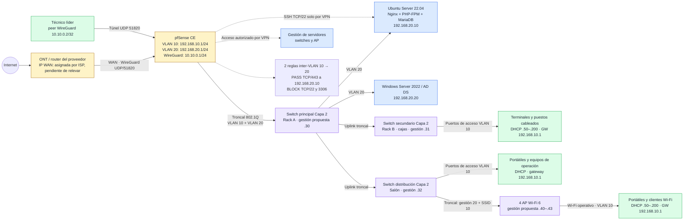

# Topología y direccionamiento vigente — PreventiTI

**Estado:** arquitectura de red aprobada según confirmación del equipo del proyecto. Esta consolidación conserva las dos VLAN, todas las IP definidas y las dos reglas inter-VLAN de la implementación aprobada.

## Diagrama lógico

## Plan de direccionamiento

| Segmento / equipo | Dirección vigente o propuesta | Máscara / asignación | Uso y estado |
| --- | --- | --- | --- |
| VLAN 10 — red | `192.168.10.0/24` | `255.255.255.0` | Clientes/POS y equipos de operación. Red documentada. |
| pfSense, interfaz VLAN 10 | `192.168.10.1` | Estática | Gateway de VLAN 10 y servidor DHCP según el diseño. Documentada. |
| DHCP VLAN 10 | `192.168.10.50–192.168.10.200` | Dinámico; gateway `192.168.10.1` | Pool documentado. No se asignan IP individuales a los activos del catálogo. |
| DNS entregado por DHCP | Valor de la implementación aprobada | Opción DHCP por documentar al exportar pfSense | El repositorio no define una IP de DNS. No se incorpora una dirección nueva. |
| VLAN 10, direcciones restantes | `.2–.49`, `.201–.254` | Reservadas fuera del pool | Usar solo mediante reserva o asignación estática planificada; no duplicar direcciones. |
| VLAN 20 — red | `192.168.20.0/24` | `255.255.255.0` | Servidores y, en la arquitectura vigente de dos VLAN, administración de infraestructura. Red documentada. |
| pfSense, interfaz VLAN 20 | `192.168.20.1` | Estática | Gateway de VLAN 20. Documentada. |
| Ubuntu Server | `192.168.20.10` | Estática | Nginx, PHP-FPM y MariaDB; HTTPS de la aplicación en TCP/443. Documentada. |
| Windows Server | `192.168.20.20` | Estática | Windows Server 2022 / Active Directory DS. Documentada. |
| Switch principal (Rack A) | `192.168.20.30` | Estática | IP de administración sugerida; aún no figura en la configuración vigente. |
| Switch secundario (Rack B / cajas) | `192.168.20.31` | Estática | IP de administración sugerida; aún no figura en la configuración vigente. |
| Switch distribución (salón) | `192.168.20.32` | Estática | IP de administración sugerida; aún no figura en la configuración vigente. |
| AP Wi-Fi 6 (Salón Norte) | `192.168.20.40` | Estática | Gestión sugerida; tráfico del SSID operativo etiquetado en VLAN 10. |
| AP Wi-Fi 6 (Salón Sur) | `192.168.20.41` | Estática | Gestión sugerida; tráfico del SSID operativo etiquetado en VLAN 10. |
| AP Wi-Fi 6 (Espera y turnos) | `192.168.20.42` | Estática | Gestión sugerida; tráfico del SSID operativo etiquetado en VLAN 10. |
| AP Wi-Fi 6 (Gerencia y administración) | `192.168.20.43` | Estática | Gestión sugerida; tráfico del SSID operativo etiquetado en VLAN 10. |
| VPN WireGuard — interfaz | `10.10.0.1/24` | Estática; UDP/51820 | Extremo del túnel. Documentado en la configuración de referencia. |
| VPN WireGuard — técnico líder | `10.10.0.2/32` | Peer único | IP del peer autorizado. Documentada como referencia; claves de ejemplo aún son placeholders. |
| WAN pfSense | Por relevar | DHCP, PPPoE o estática según ISP | El proyecto no define proveedor, IP pública ni método de asignación. |

En una red `/24`, las direcciones utilizables son `.1–.254` y el broadcast es `.255`. La tabla asigna IPs fijas únicamente a los hosts definidos por el diseño; las IPs `.30–.43` son una propuesta para administración de los tres switches y cuatro AP, no datos ya configurados.

## Distribución física y conexión

- El pfSense perimetral y el switch principal se ubican en la sala de servidores / rack.
- El switch principal transporta VLAN 10 y VLAN 20 por enlaces troncales 802.1Q; conecta los servidores y distribuye enlaces a los otros dos switches.
- El switch secundario da servicio a cajas y terminales cableadas en VLAN 10.
- El switch de distribución conecta puestos de salón y los cuatro AP. Los puertos de AP deben transportar la VLAN de gestión 20 y etiquetar el SSID operativo en VLAN 10.
- Las ubicaciones de AP corresponden a los nombres de activos del catálogo: salón norte, salón sur, espera/turnos y gerencia/administración.
- La topología aprobada conserva tres switches y cuatro AP. El catálogo conciliado de 69 activos no incluye la infraestructura que aloja el sistema como activos gestionados; ambos alcances permanecen separados.
- El catálogo actual administra 69 activos. No contiene un mapa MAC/IP para cada equipo; por eso el pool DHCP se mantiene como rango y las direcciones individuales de terminales, portátiles, cámaras, impresoras y equipos IoT quedan para reservas al relevar los dispositivos reales.

## Política de tráfico vigente

1. **Permitir:** TCP desde `192.168.10.0/24` hacia `192.168.20.10:443` para el acceso web a PreventiTI.
2. **Bloquear:** TCP desde `192.168.10.0/24` hacia `192.168.20.0/24` en puertos `22` (SSH) y `3306` (MySQL/MariaDB).
3. **Administración remota:** peer WireGuard exclusivo del técnico líder (`10.10.0.2/32`), que establece el túnel por UDP/51820 y accede a los servicios administrativos autorizados.
4. **Resolución de nombre:** los usuarios acceden directamente mediante HTTPS. `preventiti.local` debe resolver a `192.168.20.10` usando el DNS ya adoptado por el laboratorio; esta documentación no asigna un servidor DNS nuevo.

Los puntos 1 y 2 son las dos reglas inter-VLAN expresas del documento de pfSense. Los controles de WAN y de la interfaz WireGuard necesarios para operar el túnel administrativo pertenecen al transporte y acceso de la VPN; no alteran el conjunto de dos reglas entre VLAN 10 y VLAN 20. Desde VLAN 10, el criterio aprobado mantiene TCP/443 abierto al servidor Ubuntu y TCP/22 y TCP/3306 filtrados.

## Control de cambios y datos por documentar

- Las VLAN, subredes, gateways, IPs de los servidores y pool DHCP se toman de las referencias existentes del proyecto.
- Las IP de gestión `.30–.32` y `.40–.43` continúan identificadas como propuestas. No deben aplicarse sobre la infraestructura sin comprobar que coinciden con el laboratorio aprobado.
- La IP WAN, la opción DNS de DHCP, las reservas DHCP, las claves de WireGuard y las evidencias de aprobación deben obtenerse desde la configuración o las actas reales; no se inventan en el diagrama.
- La alternativa de separar CCTV/IoT, impresoras o gestión en nuevas VLAN queda fuera del alcance aprobado. Incorporarla implicaría un rediseño y no es necesaria para mantener los hitos actuales.
- Se deben conservar junto con la entrega las evidencias existentes de reglas, handshake VPN y conectividad. Desde el 22/10/2026 la aplicación comprueba conexiones TCP reales desde su servidor; esa comprobación no sustituye las evidencias inter-VLAN y VPN del laboratorio. Ver [alcance operativo](../guias/INFRAESTRUCTURA_OPERATIVA.md).

## Referencias del proyecto

- `infrastructure/configs/pfsense_rules.md`: redes VLAN, DHCP, servidores y dos reglas de filtrado.
- `infrastructure/configs/wireguard_wg0.conf`: interfaz y peer de WireGuard (valores de claves de ejemplo).
- `infrastructure/configs/nginx_preventiti.conf`: servicio HTTPS en `192.168.20.10`.
- `docs/arquitectura/DISTRIBUCION_SIMULADA_INSTALACION.md`: áreas físicas simuladas.
- `docs/planificacion/ALCANCE_Y_HITOS_ACTUALES.md`: cantidades actuales del catálogo y estado de evidencias de red.
